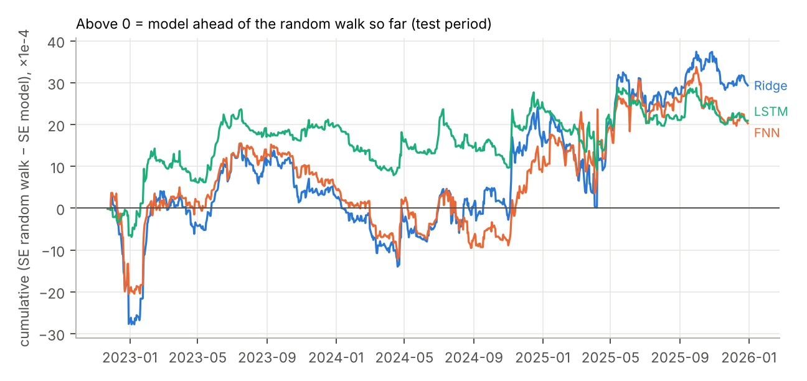

# TSLA Return Forecast

Can a neural network forecast Tesla's next-day return better than a random walk? This project tests that question under a strict no-look-ahead protocol.

**Answer: no.** An FNN, an LSTM and a Ridge benchmark were trained on 15 years of daily data. None of them beats "tomorrow's price = today's price" by a statistically significant margin on a 777-day test period. All results are reported as they came out.

| Model (test 2022-11-23 to 2025-12-30) | OOS R² vs random walk | Clark-West p (one-sided) |
| --- | --- | --- |
| Train-mean drift | 0.08% | 0.21 |
| Ridge | 0.26% | 0.10 |
| FNN, 5-seed ensemble | 0.18% | 0.11 |
| LSTM, 5-seed ensemble | 0.18% | 0.13 |
| Old design: price-level LSTM | −318.9% | 0.48 |

After the Holm adjustment for five models, every p-value is 0.51. Across 20 random seeds, the networks' test R² averages slightly below zero. Full write-up: **[reports/final_report.md](reports/final_report.md)**.



## Why returns, not prices

On this test period, the random walk alone has a price-level R² of **0.987**. Any price model inherits most of that, so a high price R² says nothing about skill. The old price-level LSTM design, rerun cleanly here, scores a price R² of 0.929, yet its price error is 2.3 times the random walk's (DM statistic −4.93). This project therefore forecasts the next-day log return, y_t = ln(C_{t+1}/C_t), and converts it to a price as C_t · exp(ŷ).

## Leakage controls

- Every feature in row t uses data up to the close of day t only. A unit test perturbs all data after T and checks that nothing dated T or earlier changes.
- The 70/10/20 split is chronological. Scalers are fitted only on the rows each model is fitted on.
- Hyperparameters are chosen on validation. Each model is refit once on the first 80% and scores the test set once.
- Prices are split-adjusted (1:5 on 2020-08-31, 1:3 on 2022-08-25), with automatic checks for unadjusted splits. The data are a hashed CSV snapshot.

## Layout

```
src/tslaf/
  data.py, quality.py      download, snapshot, split-adjustment checks
  features.py, split.py    37 features + target, chronological split
  sequences.py             daily windows for the LSTM
  models/                  ridge.py, fnn.py, lstm.py, legacy.py (old design)
  stats.py                 Diebold-Mariano, Clark-West, Pesaran-Timmermann, Holm
  walkforward.py           expanding-window refits over the test period
scripts/run_phase1..4.py   each writes reports/phaseN_report.md
scripts/make_figures.py    reports/figures/*.png
tests/                     51 tests
```

## Run

```bash
pip install -r requirements.txt
python scripts/run_phase1.py   # data, checks, split, baselines (uses the snapshot; --refresh re-downloads)
python scripts/run_phase2.py   # Ridge + FNN, about 40 s on one CPU thread
python scripts/run_phase3.py   # LSTM + old-design replication, about 8 min
python scripts/run_phase4.py   # significance tests, 20 seeds, walk-forward, about 20 s
python scripts/make_figures.py
python -m pytest
```

Phase reports: [1](reports/phase1_report.md) · [2](reports/phase2_report.md) · [3](reports/phase3_report.md) · [4](reports/phase4_report.md).
