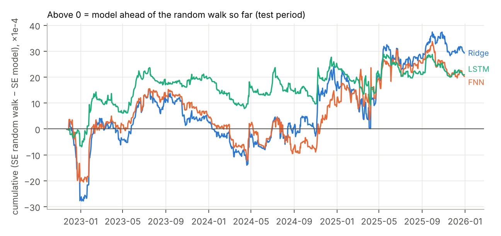
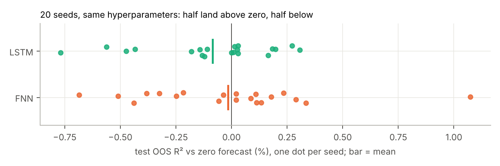
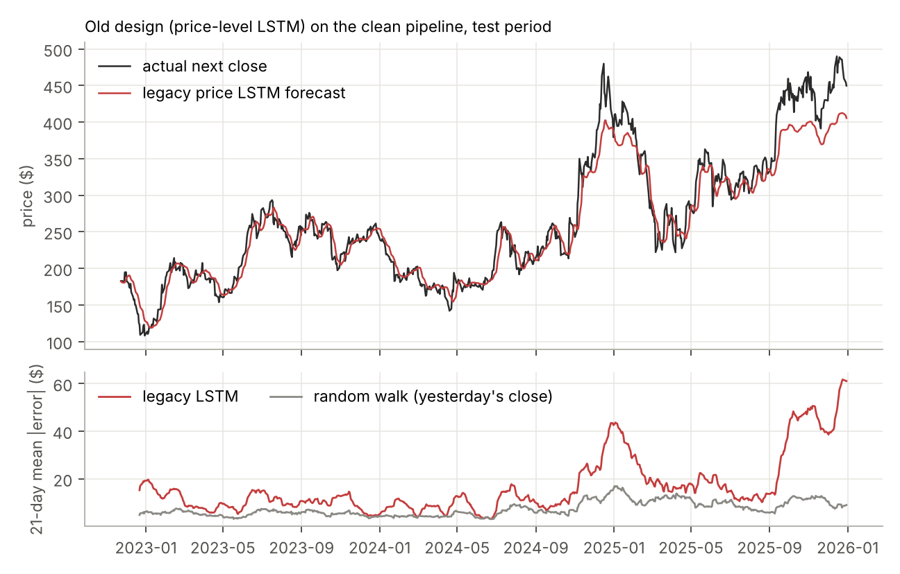

# TSLA Return Forecast: final report

Junhao Xiong. Data to 2025-12-31. Every number in this report comes from a script in this repository; the phase reports linked at the end hold the full tables.

## 1. Conclusion

None of the neural networks (FNN, LSTM) or the linear benchmark (Ridge) forecasts next-day TSLA returns significantly better than a random walk.

- On the 777-day test period (2022-11-23 to 2025-12-30), the best out-of-sample R² against the zero-return forecast is 0.26% (Ridge). The FNN and LSTM ensembles each reach 0.18%.
- Clark-West p-values are 0.10 to 0.13 before any multiple-testing adjustment and 0.51 after the Holm adjustment. No direction test (Pesaran-Timmermann) is significant either.
- Across 20 random seeds with fixed hyperparameters, test R² averages −0.02% (FNN) and −0.08% (LSTM). About half the seeds come out above zero, and 1 of 20 FNN seeds reaches p < 0.05, which is the rate chance alone produces.
- The original design, a price-level LSTM, makes the problem visible. Run cleanly on the same data, it scores a price R² of 0.929, but the random walk scores 0.987. Its price error is 2.3 times the random walk's, and it is significantly worse than the random walk (DM statistic −4.93).

The models do not fail because of the code. The same FNN and LSTM training loops learn simple nonlinear and sequential signals in the unit tests (R² > 0.8). What the data contain, at a daily horizon and with these inputs, is too little signal to beat the random walk.

## 2. Data and leakage controls

| Item | Choice |
| --- | --- |
| Source | yfinance, TSLA OHLCV + SPY, QQQ, ^VIX closes |
| Period | 2010-06-29 (IPO) to 2025-12-31, 3,902 trading days, no missing values |
| Splits | split-adjusted prices; 1:5 on 2020-08-31 and 1:3 on 2022-08-25. Adjusted returns on those days are +12.57% and −0.35% (an unadjusted series would show −80% and −66.7%). No dividends |
| Reproducibility | CSV snapshot with SHA-256; Yahoo rescales the whole history after every split |
| Target | next-day log return y_t = ln(C_{t+1}/C_t); price forecast = C_t · exp(ŷ_t) |
| Features | 37 for Ridge/FNN (20 return lags, 5/20-day realized vol, volume ratio, high-low range, close-open return, 5 lags of SPY and QQQ, VIX level and change); 8 per day for the LSTM, in 20- or 60-day windows |
| Split | chronological 70/10/20: train 2010-07-28 to 2021-05-11 (2,716), validation to 2022-11-22 (388), test (777) |

These controls stop look-ahead and leakage:

1. A row dated t uses only data up to the close of day t. A test perturbs every value after T and checks that no feature or forecast dated T or earlier changes.
2. No shuffling across time. Mini-batches are shuffled only within the training rows.
3. Scalers are fitted only on the rows a model is fitted on.
4. Hyperparameters are chosen on the validation set. The final models are refit once on the first 80% and score the test set once. The test set was never used to choose anything.
5. The walk-forward reuses hyperparameters chosen before the test period starts.

## 3. Models

| Model | Setup | Chosen on validation |
| --- | --- | --- |
| Zero forecast | random walk, the benchmark for every test | none |
| Train mean | constant drift from the fit period | none |
| Ridge | 37 standardised features, α over 0.01 to 10,000 | α = 10,000, the top of the grid (forecast shrinks toward the mean) |
| FNN | PyTorch MLP, 8 configs × 5 seeds, early stopping | (32, 16), dropout 0.1, weight decay 1e-3, 2 epochs |
| LSTM | 1 layer on daily sequences, 8 configs × 5 seeds | window 20, hidden 16, dropout 0.1, 1 epoch |
| Legacy price LSTM | old notebook design: 60-day closes, 4 × LSTM(50), MinMax, price target | 22 epochs |

Early stopping chose 1 to 2 epochs for both networks. Validation error stopped improving after that. On the test set, each model's forecasts have a standard deviation of about 0.001, compared with 0.038 for the actual returns. Both networks effectively learned a small positive drift.

## 4. Results

### Test period, models refit on the first 80%

| Model | OOS R² vs zero | Hit rate | Price RMSE ($) | Price R² |
| --- | --- | --- | --- | --- |
| Random walk | 0 | n/a | 10.19 | 0.987 |
| Train mean | 0.08% | 51.2% | 10.19 | 0.987 |
| Ridge | 0.26% | 50.3% | 10.18 | 0.987 |
| FNN, 5-seed ensemble | 0.18% | 51.0% | 10.18 | 0.987 |
| LSTM, 5-seed ensemble | 0.18% | 50.1% | 10.19 | 0.987 |
| Legacy price LSTM | −318.9% | 50.1% | 23.84 | 0.929 |

A price R² of 0.987 for a model that does nothing shows why the old resume figure (R² 0.64 on prices) said nothing about forecasting skill.



The cumulative advantage chart wanders around zero for most of the test period. Ridge and the FNN spent most of early 2024 below zero, and all three curves end only slightly positive.

### Validation is optimistic

The LSTM ensemble scored R² 1.57% on validation and 0.18% on test. The validation set was used to pick the configuration, so its score is biased upward. This is why a separate, single-use test set is needed.

### By calendar year (OOS R² vs zero)

| Year | Days | Ridge | FNN | LSTM |
| --- | --- | --- | --- | --- |
| 2022 (Nov to Dec) | 26 | −3.63% | −2.69% | −0.86% |
| 2023 | 250 | 1.13% | 0.95% | 0.95% |
| 2024 | 252 | 0.29% | 0.08% | 0.15% |
| 2025 | 249 | 0.37% | 0.30% | −0.11% |

## 5. Significance tests

One-sided tests; H1 is that the model beats the zero forecast.

| Model | DM p | Clark-West p | CW p, Holm | Pesaran-Timmermann p |
| --- | --- | --- | --- | --- |
| Train mean | 0.399 | 0.212 | 0.507 | n/a (never changes sign) |
| Ridge | 0.262 | 0.101 | 0.507 | 0.936 |
| FNN, 5-seed ensemble | 0.307 | 0.109 | 0.507 | 0.481 |
| LSTM, 5-seed ensemble | 0.238 | 0.134 | 0.507 | 0.750 |
| Legacy price LSTM | 1.000 | 0.476 | 0.507 | 0.416 |

- Diebold-Mariano: squared errors, Newey-West variance with lag 9, Harvey-Leybourne-Newbold correction.
- Clark-West is the primary test. The zero forecast is nested in every model (all coefficients set to zero), and in that case DM is undersized.
- Holm adjusts for testing five models at once.



Robustness checks:

- With 20-seed ensembles instead of 5, the FNN reaches R² 0.27% (CW p 0.079) and the LSTM 0.15% (CW p 0.168). Neither passes 5%, and both have Holm-adjusted p above 0.15.
- An expanding-window walk-forward over the test period refit every model every 63 days (13 refits). It gave the same picture: Ridge 0.25%, FNN 0.19%, LSTM 0.16%, all with CW p above 0.09.

## 6. The old design, run cleanly

The original iRisk notebook trained a 4-layer LSTM on the daily High price. It then tested the model on Open-price inputs, compared the forecasts with High, and reported R² on price levels with no benchmark. Here, that design is rerun with the input/target mismatch fixed, a fit-period-only scaler and the same split as every other model.



- In 11.6% of test days, the next close is above the highest close in the fit period ($409.97). A MinMax-scaled network has never seen a target above 1, so in late 2024 and late 2025 its forecasts flatten out below the actual price. The average error is −$8.26.
- On price levels, it loses to the random walk with DM statistic −4.93, so the loss is significant.

## 7. Limitations

- One stock, daily horizon, public price and volume data only. The result is about this setup, not about return predictability in general.
- The test period, late 2022 to 2025, is one market regime. The walk-forward covers only that period, because reusing hyperparameters tuned on 2021 to 2022 data for earlier years would leak information.
- The hyperparameter grids are small (8 configurations per network). Ridge chose the edge of its grid; a larger α only moves its forecast closer to the train mean, which is already in the table.
- Squared-error loss treats all days alike. An economic test, such as trading costs and position sizing, is outside the scope of this project.

## 8. Reproduce

```bash
pip install -r requirements.txt
python scripts/run_phase1.py   # data, quality checks, split, baselines
python scripts/run_phase2.py   # Ridge + FNN, about 40 s
python scripts/run_phase3.py   # LSTM + legacy replication, about 8 min
python scripts/run_phase4.py   # significance, 20 seeds, walk-forward, about 20 s
python scripts/make_figures.py
python -m pytest               # 51 tests
```

Phase reports: [1](phase1_report.md) · [2](phase2_report.md) · [3](phase3_report.md) · [4](phase4_report.md).
